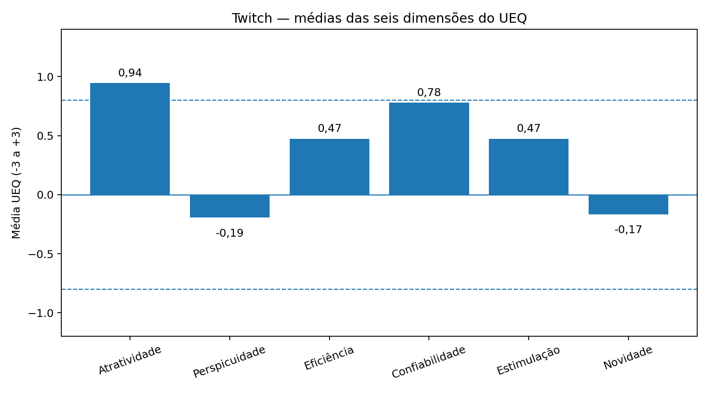

# Avaliação de Experiência do Usuário — Twitch

## 1. Aplicação do UEQ

Foi utilizado o User Experience Questionnaire (UEQ) para avaliar a experiência de uso da Twitch. As respostas numéricas de **9 participantes** constam na aba `Data` da planilha analisada. A ferramenta calcula as médias das seis dimensões e compara os resultados com uma base de referência (*benchmark*).

## 2. Resultados gerais

| Dimensão | Média | Classificação no benchmark |
|---|---:|---|
| Atratividade | 0,94 | Below average |
| Perspicuidade | -0,19 | Bad |
| Eficiência | 0,47 | Bad |
| Confiabilidade | 0,78 | Bad |
| Estimulação | 0,47 | Bad |
| Novidade | -0,17 | Bad |

**Figura 1 — Médias das seis dimensões do UEQ para a Twitch.**

A maior média foi observada em **Atratividade** (0,94), seguida por **Confiabilidade/Controle** (0,78). A menor média foi a de **Perspicuidade/Transparência** (-0,19), seguida por **Novidade/Inovação** (-0,17). Segundo os critérios da ferramenta, médias acima de 0,8 são positivas; valores entre -0,8 e 0,8 são neutros; e valores abaixo de -0,8 são negativos. Assim, apenas Atratividade ficou na faixa positiva, enquanto as outras cinco dimensões ficaram na faixa neutra.

## 3. Análise quantitativa

### 3.1 Gráfico das médias das dimensões

O primeiro gráfico compara as médias das seis dimensões avaliadas. Atratividade foi a única dimensão com resultado acima de 0,8, indicando a avaliação mais favorável do conjunto. Confiabilidade/Controle obteve 0,78, muito próximo do limite positivo, enquanto Eficiência e Estimulação tiveram médias iguais a 0,47. Perspicuidade/Transparência (-0,19) e Novidade/Inovação (-0,17) foram os resultados mais baixos, embora ainda dentro da faixa neutra. Esses valores sugerem que a compreensão e a aprendizagem do sistema, assim como a percepção de inovação, merecem atenção na análise complementar.

### 3.2 Comparação com o benchmark

**Figura 2 — Médias e classificação comparativa no benchmark do UEQ.**

A planilha classifica Atratividade como **Below Average** (abaixo da média) e as outras cinco dimensões como **Bad** (na faixa dos 25% piores resultados da base de referência). Isso demonstra que a dimensão relativamente mais forte dentro deste grupo não necessariamente apresenta desempenho alto quando comparada a outras avaliações presentes no benchmark. A classificação do benchmark é diferente da interpretação da média na escala: a primeira compara com uma base externa, enquanto a segunda considera os intervalos de -3 a +3 do UEQ.

## 4. Análise qualitativa

Esta seção deve ser completada com as respostas abertas dos participantes. No ATLAS.ti, importem os comentários, codifiquem trechos reais das respostas e documentem os códigos identificados. Não criem códigos apenas com base nas médias numéricas: cada código precisa estar fundamentado em um comentário efetivamente coletado.

### 4.1 Respostas abertas analisadas
Inserir as respostas abertas originais, organizadas por participante.

### 4.2 Processo de codificação no ATLAS.ti
Inserir capturas de tela que mostrem os trechos codificados e os códigos associados.

### 4.3 Códigos identificados
Listar os códigos criados a partir das respostas reais e explicar brevemente o que cada um representa.

### 4.4 Redes construídas no ATLAS.ti
Inserir as seis redes, uma para cada dimensão: Atratividade, Perspicuidade, Eficiência, Confiabilidade, Estimulação e Novidade.

## 5. Considerações sobre a experiência do usuário

Os resultados indicam uma percepção mais favorável de Atratividade, enquanto Perspicuidade e Novidade apresentaram as menores médias. Entretanto, a comparação com o benchmark mostra que Atratividade ficou abaixo da média de referência e que as demais dimensões foram classificadas na faixa dos 25% piores resultados do benchmark. Portanto, os dados apontam oportunidades de melhoria em diferentes aspectos da experiência de uso da Twitch. A interpretação final deverá ser complementada pelas respostas abertas e pelas redes de códigos construídas no ATLAS.ti, de modo que as conclusões considerem tanto os resultados quantitativos quanto os relatos dos participantes.
